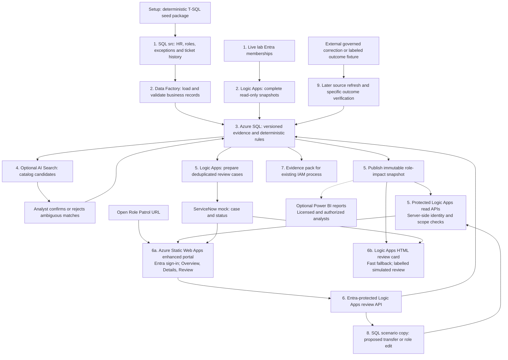
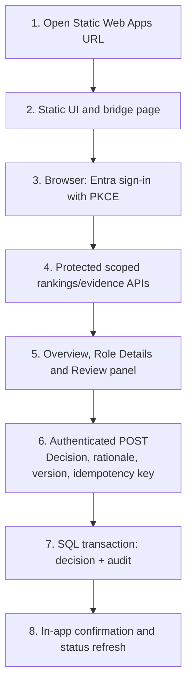
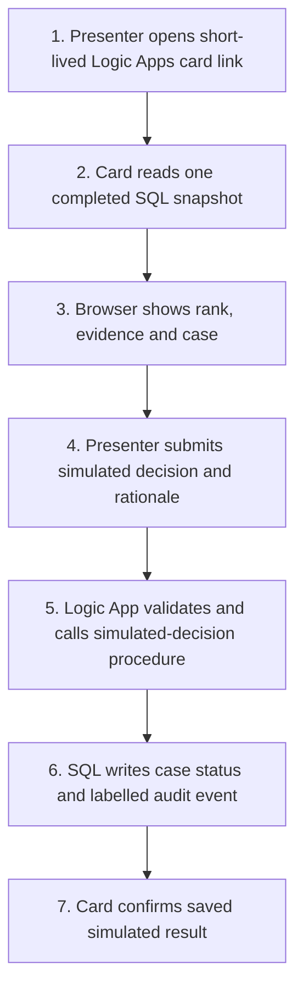

# Role Patrol

## Revised Azure Hackathon Project Design and Build Guide

**Version:** 1.3 | **Updated:** 7 October 2026  
**Basis:** [Astra comparative report](Astra_report.md), the revised project flow and the confirmed hackathon constraints.

**Business promise:** Rank business roles by distinct employees with verified post-transfer access complaints, identify upcoming transfers needing review, and give the accountable owner evidence for an early decision.

This document specifies the project to build. It includes architecture, rules, data contracts, an executable-deliverable plan, a test-data generation prompt and demo acceptance criteria. It does not claim that resources, code or datasets have already been deployed or validated.

## 1. What the MVP delivers

| Business question | MVP behavior |
|---|---|
| Could an upcoming transfer interrupt work? | Preview access under the target role and the explicit demo mover policy; flag conditional loss of potentially needed access. |
| Could a proposed business-role edit have a negative impact? | Apply additions/removals to a scenario copy and show potentially affected current members, known retaining assignments, exceptions and unknowns. |
| Which access tickets followed an employee's role change? | List verified access complaints by mover event, employee, entitlement and time window, with raw and deduplicated counts. |
| What is the productivity impact? | Show observed resolution delay where available, separate support effort, and explicitly labeled employee-interruption estimates. |
| Do role definitions and directory groups disagree? | Compare governed entitlements with mapped live lab Entra memberships. On-premises AD is outside this demo. |
| Do similar employees show discrepancies? | Compare active, observed peers within the same role triple and compatible work context. Explain exceptions and coverage. |
| What should the owner do? | Suggest business-need validation, standard role review, exception review or provisioning investigation, with evidence and a named owner. |
| Which business roles cause the greatest observed employee disruption? | Rank by distinct affected employees using versioned assessment snapshots, with ticket evidence, observation period and owner. No weighted score or AI ranking. |

The runtime never grants/removes access, changes the authoritative role definition, certifies access or closes employee access tickets. It writes its own evidence, findings, cases, decisions, audit records and scenario results. Corrections remain in the organization's normal IAM process.

**Halfway demo:** A completed, reproducible assessment ranks roles from source records; the browser application drills into UK Finance's eight affected employees and Jane's upcoming transfer; the owner opens its Review panel, submits an authenticated decision, and sees its persisted status. One exception and one unknown case demonstrate restraint. AI is off.

**Final planned demo:** Preserve that working path, then add isolated what-if previews, assessment comparison, broader counterexamples and optional search/outcome demonstrations. Halfway is a delivery checkpoint, not permission to skip authorization, evidence validation or audit. Blocked lab capabilities are disclosed rather than counted as passed.

## 2. Fixed scope and constraints

| Area | Decision |
|---|---|
| HR and SailPoint | Synthetic data only; no corporate connectors or credentials. |
| ServiceNow | Mock API inside the lab, backed by Azure SQL. Synthetic-data-only fallback is acceptable. |
| Entra ID | Live lab read access. Fictional demo identities and direct security-group memberships are prepared separately. |
| Allowed cloud components | Azure Static Web Apps, Azure Data Factory, Azure SQL, Azure Logic Apps, Azure AI Search, Power BI and Entra ID; ServiceNow is mocked. |
| Data staging | SQL `src` schema, populated by repeatable T-SQL seed scripts; no storage account or file-hosting service. |
| Mock hosting | HTTP-triggered Logic Apps with SQL persistence. If the mock HTTP path is unavailable, use explicitly labeled synthetic SQL records. |
| Business interface | Two browser UI modes: a Logic Apps HTML review card for a fast, limited demo; Azure Static Web Apps for the full manager/leadership portal. Both use Logic Apps workflows and the same SQL evidence; optional Power BI reports remain analyst-only (§6). |
| AI | Optional semantic retrieval; structured mapping and curated aliases first; human confirmation before semantic candidates count as verified evidence. |
| Deferred | Broad sibling-role recommendations, large-scale role mining, complex health scores, chatbots, vector embeddings and optional email/Teams notifications. |

Entra membership proves membership in a mapped test group. It does not prove that a real application's login, license or authorization works. Preview results are conditional on the stated assignment policy and known provenance.

### 2.1 Requirements allowlist and restricted-lab boundary

The original service allowlist comes from [requirements.md](requirements.md). The project decision adds **Azure Static Web Apps** as the approved browser-hosting service: **Azure Static Web Apps, Azure AI Search, Azure Logic Apps, Azure SQL Database, Datafactory, Power BI, Entra ID and ServiceNow APIs (mock only)**. HR, SailPoint and ServiceNow production connections are prohibited.

| Allowed service | Role in this design | Restriction-aware choice |
|---|---|---|
| Azure SQL Database | Synthetic sources, evidence, rules, cases, scenarios and audit | T-SQL setup/seed/reset and SQL-backed mocks; scoped identities. |
| Datafactory (Azure Data Factory) | Source ingestion and assessment orchestration | Existing permitted integration runtime and SQL/network connections only. |
| Azure Static Web Apps | Enhanced browser portal, MSAL redirect page and accessible UI | Free tier for the demo; static files only, with no API backend or secrets. Build after the fast card works. |
| Azure Logic Apps | Membership reads, protected APIs, mock tasks and the fast HTML review-card UI | Consumption plan only where its endpoints/connectors work under lab policy. |
| Entra ID | Lab membership observations and reviewer authentication | Admin-provided registrations, grants and identities may be necessary. |
| Power BI | Optional analytical reports using the same SQL evidence | Only licensed/authorized analysts; absence does not block application users or the core demo. |
| Azure AI Search | Optional catalog candidate retrieval | Off by default until provisioned/permitted; no generative model dependency. |
| ServiceNow mock API | Synthetic tickets and Role Patrol review tasks | Logic Apps + SQL; no real instance, credentials or platform UI. |

**No additional service dependencies:** no App Service, Functions, Storage/Blob/Azure Files, Key Vault, API Management, Power Apps, Power Automate, Dataverse, Azure OpenAI, Teams/Outlook connectors, hosted CDN or external web host. Azure Static Web Apps is the one approved static-hosting exception. Use built-in run history and SQL audit; no separate monitoring service is required. Do not switch to Logic Apps Standard as a workaround because it introduces a storage dependency outside this design.

The enhanced browser experience executes a packaged HTML/CSS/JavaScript application from Azure Static Web Apps. A separate Logic Apps HTML card is retained as the fast build and presentation fallback. Logic Apps never expose a callback SAS as an OAuth redirect URI. A callback link is permitted only for the clearly labelled, time-limited demo-card fallback; its simulated decisions never count as authenticated owner actions. Custom browser code, any packaged authentication library and setup tools still need to comply with lab policy. No Python installation, Tkinter, Postman, Cloud Shell or local HTTP server is required. An optional offline generator can prepare artifacts outside the lab only where permitted; a checked T-SQL seed package is the in-lab path.

An allowed service is not proof that a connector, SKU, public endpoint, delegated permission or tenant registration is available. Record the actual restrictions before implementation (§5.3). Do not open firewalls broadly, add tunnels, substitute personal tenants or request broader privileges to bypass a restriction.

## 3. High-level architecture and numbered data flow



| Step | Event | Output |
|---|---|---|
| 1 | Prepare synthetic business records and independently seed lab identities/groups. | Fictional source data, identity mapping and expected setup manifest. |
| 2 | Ingest business records and read all pages of required Entra groups. | Validated source batch and complete membership collection, or explicit failure/unknown state. |
| 3 | Resolve IDs, effective role versions, assignment origin, exceptions and mover-ticket attribution. | Versioned evidence and scoped findings. |
| 4 | For ambiguous ticket wording, optionally retrieve existing catalog candidates and request analyst confirmation. | Confirmed match or unresolved ticket; the latter does not inflate evidence. |
| 5 | Publish role-impact counts/ranks and evidence atomically; show the latest complete assessment and prepare review cases. | Ranked roles, affected employees, period, evidence quality, owner and due date. |
| 6 | The authorized manager records business need and a decision. | Audited decision, not a change to access. |
| 7 | Record the normal IAM handoff and any external reference. | Trackable work item with accountability. |
| 8 | Evaluate an isolated role/transfer scenario. | Before/after projection with affected members and assumptions. |
| 9 | Ingest later evidence of an external action. | Separately verified role update, membership observation or functional restoration. |

Steps 2's independent loads can run in parallel; publish an assessment only after the required source runs are complete. A failed feed must not be interpreted as an empty access set.

## 4. Component responsibilities

| Component | Concrete implementation responsibility |
|---|---|
| Synthetic setup package | Repeatable T-SQL seed/reset/validation scripts populate SQL. Optional offline generation prepares these artifacts without enterprise connectivity. |
| Azure Data Factory | Copies `src` records to staging, validates source completeness and keys, calls SQL transformation/assessment procedures and coordinates a completed assessment run. |
| Entra ID | Supplies direct membership observations and authenticates the two demo reviewers. Runtime permissions are read-only toward the directory. |
| Azure SQL | Holds source/staging/core/case/audit/scenario data, applies deterministic logic and exposes report/evidence views. |
| Azure AI Search | Indexes a sanitized entitlement catalog. Keyword/alias search works without semantic ranking; approved semantics can propose matches. |
| Logic Apps membership workflow | Reads configured groups, follows pagination and publishes a complete snapshot. |
| Logic Apps review workflows | Create cases, enforce reviewer scope, record decisions, support mock APIs and update overdue-review status. |
| ServiceNow mock | Uses synthetic ticket history and separate review-case records; preserves correlation IDs and realistic response shapes. |
| Power BI | Optional read-only Priorities, Role Evidence and Review/Outcomes reports for licensed analysts; uses the same SQL evidence and scoped data. |
| Azure Static Web Apps | Enhanced browser portal: Overview, Role Details, Review and later History/What-if. Hosts static assets and MSAL redirect page; no secrets, direct SQL credentials or directory writes. |
| Logic Apps HTML review card | Fast browser fallback for a single ranked role/case and a labelled simulated review. It is built first, reads the same frozen SQL evidence and contains no OAuth redirect URI. |
| Logic Apps review APIs | Entra-protected API workflows for the enhanced browser portal; direct SQL credentials or directory writes are never exposed. |

## 5. Azure resource and identity plan

### 5.1 Provisioning inventory

Use the assigned resource group and permitted region. Create a dedicated group such as `rg-role-patrol-demo` only if allowed. Prefer admin-provisioned resources when creation is restricted. Resource names below are suggestions; add a unique suffix where necessary.

| Resource | Suggested name | Setup choice |
|---|---|---|
| Azure SQL logical server/database | `sql-rp-<suffix>` / `sqldb-role-patrol` | Small permitted tier; configure Entra administrator and scoped database permissions. |
| Azure Data Factory | `adf-role-patrol-<suffix>` | Managed identity; linked services to SQL and permitted HTTPS endpoints. |
| Azure AI Search | `srch-role-patrol-<suffix>` | Small allowed tier; validate optional semantic feature availability separately. |
| Azure Static Web Apps | `swa-rp-portal` | Free static-hosting tier; no linked Functions/API backend. |
| Logic Apps | `la-rp-memberships`, `la-rp-cases`, `la-rp-mock`, owner-review workflows | Consumption request/recurrence workflows as the default, provided lab networking supports the required connectors. |
| Optional Power BI workspace/report | `Role Patrol Demo Analytics` | Provision only if permitted for licensed analysts; validate sharing/RLS. Not a core application dependency. |
| Entra API registration | `RolePatrol-Review-API` | Expose the delegated review scope; validate issuer/audience and permitted reviewer identity. |
| Entra SPA registration | `RolePatrol-Review-Browser` | Single-tenant browser sign-in with PKCE; exact tested callback URI; no client secret. |

Do not assume a subscription Contributor role grants tenant application consent or demo-user creation rights. Establish permitted setup actions and connector/network access at the beginning of the build. All cloud-to-cloud calls use lab-approved connectivity. Do not bypass a private-network restriction by opening a service broadly.

### 5.2 Separate setup, runtime and reviewer privileges

| Identity | Allowed capabilities | Excluded capabilities |
|---|---|---|
| Authorized setup identity | Create/match demo users/groups, apply schema, seed/reset demo data and configure permissions. | Routine application execution using administrative credentials. |
| ADF managed identity | Read synthetic sources; load staging; execute named merge/assessment procedures. | Evaluation ground truth, directory writes and arbitrary review decisions. |
| Membership workflow identity | Approved Graph membership reads; insert collection rows through dedicated SQL procedures. | Directory/group writes, certifications and role changes. |
| Case workflow identity | Execute case upsert/status procedures and call the mock. | Direct modification of source roles or membership evidence. |
| Review API identity | Read authorized evidence through procedures; record allowed decisions using a trusted reviewer identity. | Arbitrary SQL, role edits or access grants. |
| Search identity | Read the sanitized catalog view only. | Employee tables, raw tickets, evaluator labels and decision writes. |
| Optional Power BI identity/users | Read approved reporting views; licensed analysts receive appropriately scoped Viewer access. | Core-table edits, evaluator labels and backend API authorization by implication. |

Choose Graph permissions from the actual endpoints/fields used. The current direct-member API provides endpoint-specific least-privilege guidance and does not expand nested groups. The demo therefore uses direct user memberships. A query allowlist limits application behavior but does not narrow the tenant-wide scope of a granted application permission. [Microsoft Graph membership documentation](https://learn.microsoft.com/en-us/graph/api/group-list-members?view=graph-rest-1.0).

Use managed identities for Azure service connections where supported and granted. Database users still need explicit SQL permissions. ADF's SQL connector supports managed-identity authentication and stored-procedure processing. [Microsoft ADF SQL connector](https://learn.microsoft.com/en-us/azure/data-factory/connector-azure-sql-database).

### 5.3 Restricted-lab readiness gate

Maintain `docs/lab_readiness.md` with capability, actual result, owner, evidence and selected fallback. Every entry starts **Pending**, not Assumed available. These checks request only the capabilities needed for this design, not unrestricted tenant access.

| Check | Required evidence before relying on it | If unavailable |
|---|---|---|
| Resource/SKU/region/quota | Assigned resource inventory and permitted creation/update actions | Reuse approved resources; record missing features. |
| Entra setup and Graph | Admin-provided users/groups, mappings, consent and successful direct membership read | Use supplied cohort if equivalent; otherwise show labeled FixtureReplay, with live Entra capability unproven. |
| API/SPA registrations | Exact callback accepted, delegated consent, two scoped reviewer identities | SQL simulation; no authenticated-owner claim. |
| Browser delivery | Primary application URL, HTML/JS assets and Entra endpoints reachable under conditional access | Presenter-only SQL simulation or labeled recording; no tunnel/public-network workaround. |
| Browser/API boundary | PKCE return, scope/owner checks, same-origin or working restricted CORS/OPTIONS | Stop the interactive review branch until resolved within permitted services. |
| SQL from each service | ADF and Logic Apps identities execute a harmless procedure over permitted routes | Do not enable broad network access; use only permitted SQL/report demonstration, or record blocked build. |
| Consumption connectors/network | Graph, SQL and HTTP actions work under actual connector policies | Use SQL-only synthetic mock where applicable. If private-only policy cannot support Consumption, HTML hosting is blocked; do not add Standard/Storage. |
| Search and semantics | Catalog-only indexing/query permissions and permitted tier/features | AI off; structured/approved aliases and human triage remain. |
| Optional Power BI | License, report authoring/sharing, source credentials and actual Viewer RLS test | Omit analytical reports; web application remains the complete core user journey. |
| Seed and fallback | Portal Query Editor or lab-provided SQL tool can run approved scripts | Admin loads reviewed seed; if neither path exists, record the data setup blocker. |

Configure only lab-approved network endpoints. Consumption connector traffic and browser-origin traffic are different paths; a successful portal sign-in proves neither SQL connector access nor Graph permission. Managed identities require explicit service/database grants. Store no runtime secrets in the page; use managed identities where supported and protected native connection settings only if allowed. Do not add Key Vault or other services to work around missing permissions.

Set run labels independently: `membership_mode = EntraLive | FixtureReplay`, `review_mode = EntraHtml | SqlSimulation | Unavailable`, and `mock_mode = LogicAppsSql | SqlSynthetic`. A degraded demo may still show useful evidence, but it does not satisfy the corresponding live acceptance checks.

## 6. Two browser UI modes: Logic Apps fast card, Static Web Apps portal and optional Power BI

### 6.1 Delivery decision and build order

Use two browser modes under the same **Role Patrol** name. They are not competing products: the Logic Apps card proves the business story quickly, while Static Web Apps supplies the polished, authenticated experience when time permits.

| Mode | Build order | What the user sees | Decision status | Purpose |
|---|---:|---|---|---|
| **Logic Apps HTML review card** | First | One ranked role, a selected employee/case, key evidence, and **Request IAM review / Needs information / Not required** buttons | `SIMULATED_DEMO_DECISION`, clearly labelled | A working browser demo with only Logic Apps and SQL when time, Node setup, or SPA authentication is constrained. |
| **Static Web Apps portal** | Second | Overview, role ranking, detail drill-down, worklist, history and polished review panel | Authenticated owner decision after Entra/PKCE validation | The primary adoption-ready UI for leaders, managers and IAM. |

Both modes read the same completed SQL assessment and call the same deterministic procedures. The card never grants access, changes a role, impersonates an owner or hides that its decision is simulated. Its callback URL is a time-limited demo mechanism, not an Entra redirect URI or a production authorization design.

Azure Static Web Apps hosts the fixed HTML/CSS/JavaScript package and same-origin `bridge.html` sign-in return page. It has no API backend, SQL connection, employee evidence, evaluator data or decision credentials. Logic Apps retain protected workflow/API responsibilities. Both interfaces label the task panel **Mock ServiceNow Review Task**; neither claims to be a real ServiceNow UI or integration.

Package all assets with the deployment; no CDN, external fonts, package download at runtime or localhost listener. Keep the page small and version the static package with the workflows. Do not add an Azure Functions API to Static Web Apps: the project uses only its static-hosting capability.

### 6.2 Fast Logic Apps card — the half-time safety net

Create one Consumption Logic App with an HTTP GET trigger that returns a styled, self-contained HTML evidence card. It accepts only a fixed demo case reference, retrieves the selected completed snapshot through its managed-identity SQL connection, and renders server-side values with HTML encoding. A POST from the card calls a companion Logic App action that validates the allowed decision/rationale and invokes `casework.usp_RecordSimulatedDecision` with the case version and idempotency key.

Use a short-lived callback URL only during the presentation. Keep it out of source control, logs, bookmarks, Power BI, and the Static Web Apps configuration. The page must display **“Demo fallback — simulated reviewer decision”** before its buttons and after save. The audit record stores the actual workflow/setup identity, the simulated owner separately, the evidence version and `SIMULATED_DEMO_DECISION`.

The fast-card acceptance path is: open the browser link → view the UK Finance rank and Jane evidence → submit a labelled simulated IAM-review request → refresh the card → show the SQL audit/status. It proves the problem, frozen evidence, controlled workflow and no-remediation boundary within the first half of the hackathon. It does not prove manager authentication.

### 6.3 Static Web Apps authentication feasibility gate — build second

A Consumption request trigger validates a supplied OAuth bearer token; it does not provide an interactive website login. A normal browser hyperlink and plain HTML form cannot supply that token automatically. The browser must sign in to Entra and use JavaScript authenticated requests for evidence and decisions.

Use a single-tenant Entra SPA registration with authorization code flow and PKCE, with delegated permission to `RolePatrol-Review-API`. No client secret belongs in browser code. If the lab permits a pinned MSAL browser library, include its approved bundle in the Static Web Apps assets, without CDN access. It is a code dependency, not an additional Azure service; record permission to use it rather than assume it appears in the service allowlist. If the library or custom browser code is prohibited, use the fallback in §6.6; do not implement an improvised OAuth replacement under hackathon time pressure. [Microsoft SPA/PKCE guidance](https://learn.microsoft.com/en-us/entra/identity-platform/migrate-spa-implicit-to-auth-code).

The browser starts at the stable, non-secret Static Web Apps hostname. Register `https://<static-app-host>/bridge.html` as the SPA redirect URI. This removes the unsafe pattern of registering a Logic Apps callback URL containing a SAS signature. The Static Web App contains no business data and cannot authorize evidence reads or decisions.

Keep the dynamic case ID in the fragment or transient browser state, not in the registered redirect URI. Use organizational accounts only. Handle return navigation and validate OAuth state through the approved library. Keep tokens in memory where possible and clear transient authentication state on completion/sign-out. [Microsoft redirect URI restrictions](https://learn.microsoft.com/en-us/entra/identity-platform/reply-url).

The first technical spike must prove, in the actual lab: shell delivery, permitted script execution, Entra sign-in and redirect, token acquisition for the right API, authorized evidence retrieval and a protected POST. Check actual origins of the generated workflow URLs. Prefer a verified same-origin layout; if origins differ, the exact-origin CORS policy and unauthenticated OPTIONS preflight must work without exposing business operations. Do not treat CORS as authorization or disable OAuth to make a preflight succeed. If the platform/policy cannot support this arrangement, use §6.6. Record these checks as Pending until executed.

### 6.4 Numbered flows



A judge without an authorized lab identity can watch the presenter or see a redacted recording; possession of the link does not grant case access.



### 6.5 Authorization and decision integrity

Protect evidence, decision, match-confirmation and scenario APIs with Entra OAuth and disable alternate SAS authentication on those APIs. Require the trusted tenant/issuer, audience, valid token and delegated scope. Static UI hosting grants no API access. [Microsoft Logic Apps security configuration](https://learn.microsoft.com/en-us/azure/logic-apps/logic-apps-securing-a-logic-app).

For the small demo, use principal-specific protected read/review workflows with an authorization policy requiring the configured principal's `oid`, and bind that principal ID in trusted workflow configuration. Read procedures resolve its current reporting/employee-detail/IAM scopes; owner-decision procedures independently resolve owner authority. Validate the delegated scope and trusted SPA client claim for the configured token version before any SQL action. SQL rechecks current owner scope and prevents self-review. Match confirmation also requires analyst authority. A leadership principal must not be routed through another owner's identity just to display rankings. Do not use an unvalidated decoded token or client-supplied actor ID as authority. A larger rollout needs a maintained shared authorization model rather than one workflow set per principal.

GET returns only authorized evidence and never records a decision. POST accepts only the allowed decision, rationale, expected case version and idempotency key. Validate schema, lengths and transitions; use parameterized stored procedures. Commit decision, case status and append-only audit atomically. A repeated identical request returns the saved result; a reused key with changed content or stale version is rejected.

Render untrusted text as text, not executable HTML. Use restrictive tested content-security headers, `Cache-Control: no-store` and `Referrer-Policy: no-referrer`; prevent framing and avoid third-party assets. Secure workflow inputs/outputs containing tokens, authentication codes or sensitive evidence; never log bearer tokens. Include expiry, denied access and stale-case messages. Disabling a button is only a usability measure; enforce all controls at the backend.

### 6.6 In-app Review panel and lifecycle

Show employee/role, transfer date, application, reason, evidence counts, source/run timestamps, uncertainty, owner and due date. Actions are **Request IAM review**, **Needs information**, **Not required**. Capture rationale and optional external reference. An exception recommendation means request exception review; it never creates an authoritative exception. Do not call submission a role change, access grant or verified resolution.

```text
Open -> In review -> Handoff requested -> Awaiting external action
     -> Needs information              -> Awaiting verification
     -> Rejected                       -> Verified or Reopened
```

Store workflow status separately from evidence quality (`Complete`, `Partial`, `Stale`, `Unknown`) and urgency (`Urgent`, `Review`, `Routine`). The application confirms the persisted decision ID/version immediately and re-fetches current case status within the same interface. Scenario and analyst controls reuse the protected API boundary and are visible only to authorized roles.

### 6.7 Restricted-lab fallback

If Static Web Apps sign-in or endpoint access is blocked, use the Logic Apps HTML card as the presenter fallback. It remains a browser UI and retains SQL-backed evidence, the synthetic review case, controlled decision validation and audit. Record `SIMULATED_DEMO_DECISION`, the actual workflow/setup identity, the simulated owner separately, rationale, case version and unique submission key. Reuse domain validation and atomic audit handling; simulated records cannot count as authenticated-owner decisions or verified outcomes. Only a setup/demo identity may run this fallback, never the runtime reviewer workflow.

If the Logic Apps card cannot be reached, use Azure SQL's browser Query Editor, if available under lab networking and database permissions, to execute the restricted `casework.usp_RecordSimulatedDecision` procedure. This is a technical fallback, not the preferred presentation UI.

If SQL access is also unavailable, show a labeled previous-run recording or exported evidence. Neither fallback demonstrates live manager authentication. Cloud Shell, Postman, extra services, signed decision links and shared administrator identities are not default workarounds. [Azure SQL portal Query Editor](https://learn.microsoft.com/en-us/azure/azure-sql/database/query-editor?view=azuresql).

### 6.8 Overall presentation — two UI modes, optional Power BI

**Role Patrol's Azure Static Web Apps browser application is the primary interface for managers, leadership and IAM once authentication is proven.** The Logic Apps HTML card is the deliberately smaller, fast fallback UI. Both work in a permitted browser; users do not need Power BI accounts/licenses or desktop software. Power BI remains an optional read-only analysis tool for appropriately licensed and authorized analysts. It is not embedded, does not supply authentication to the application and is never a prerequisite for a review.

Use one configured Static Web Apps URL and a common navigation/header. The static package contains no business data; JavaScript loads only authorized data through Logic Apps APIs. Keep business logic, counts and authorization in SQL/API procedures rather than duplicate calculations in the browser. The same SQL evidence/views support optional Power BI reports.

| Area in the web application | Leadership | Managers / role owners | IAM team |
|---|---|---|---|
| **Overview** | Ranked roles within authorized portfolio, affected-employee counts and review progress. | Owned roles, pending reviews and upcoming transfer warnings. | Assigned cases, overdue work and data-quality issues. |
| **Role Details** | Aggregate impact and accountable owner; employee details only if separately authorized. | Affected employees, tickets, historical role versions, peer context and exceptions. | Authorized technical evidence, source completeness and assignment provenance. |
| **Review panel** | Read-only progress unless separately granted owner authority. | Request IAM review, Needs information or Not required, with rationale. | Record permitted handoff/work references; analyst-authorized ticket matching. IAM access alone cannot impersonate a role owner. |
| **History / What-if** — after halfway | Assessment comparisons and verified outcomes. | Prior evidence and isolated previews for owned roles. | Scoped scenarios and subsequent source verification. |

The first-half safety net is the single Logic Apps evidence/review card. The enhanced first-half UI is three Static Web Apps views: Overview, Role Details and an inline Review panel or modal. The selected role/case/assessment remains in application state so users never copy IDs or switch tools. History and What-if controls arrive after the core demo works. Optional Power BI can mirror Priorities, Role Evidence and Review/Outcomes for deeper analysis; building it does not delay either browser UI.

Every browser read and write is authorized server-side. Explicit Entra principal-to-scope mappings cover leadership aggregates, employee detail, owner decisions and IAM/analyst actions separately. Filter authorized roles before calculating displayed rank; show the ranking scope and eligible-role count. Leadership aggregate access must not download employee rows hidden by CSS. IAM worklists are scoped, not automatically tenant-wide. Current permissions also apply to historical snapshots. Do not treat workspace permissions or a hidden button as application authorization.

The browser initially loads the latest completed assessment, pins that run ID for subsequent drill-downs and displays the evidence date. Refresh loads a new completed assessment explicitly. Show current case status and case version separately from historical evidence. On save, display the persisted decision reference and re-fetch the case/worklist from the API; no Power BI refresh is needed. If newer evidence supersedes the case, require review of that evidence before submitting. Historical snapshots are read-only. Deep links carry only non-secret references and must be reauthorized; never accept arbitrary return URLs.

**Visual design:** use a consistent header and compact navigation, readable system fonts, generous spacing, clear tables, restrained summary cards and simple inline SVG/CSS bars. Use text with color for urgency and evidence quality. Include keyboard navigation, labeled controls, visible focus, readable contrast, loading/empty/error states, source freshness and a clear save confirmation. Use real HTML text for ticket content, not executable markup. Avoid external fonts, CDNs, chart services, elaborate animations and new frontend frameworks. Keep static assets versioned in Azure Static Web Apps, with bounded API payloads, server-side pagination/filtering and no continuous polling.

Aesthetics improve clarity from the first build; advanced charting is optional. Cache only the non-sensitive static package if policy permits; sensitive API responses remain no-store. Static Web Apps authentication feasibility is §6.3's second-stage gate. Static Web Apps supplies a stable browser origin, but Logic Apps endpoint origins and CORS preflight must still be tested in the lab. Fail closed and use the disclosed presenter fallback if blocked.

## 7. Rules and calculations

### 7.1 Assessment clocks and evidence gates

Set the reproducible business analysis time to `2026-10-06T12:00:00Z` and seed to `42`. Derive synthetic relative dates from that clock. Each live collection also records its **actual execution time**; calculate live freshness against actual execution time, not the frozen business clock. Label the combined display “Demo business date / live lab observation time.” Never backdate a live observation to make it look historical.

Before using a fact, validate the employee/entitlement mapping, role version, source coverage, freshness and required exception/provenance completeness. Initial demo freshness is 24 hours; post-transfer provisioning grace is 24 hours. Both are configuration, not enterprise policy.

### 7.2 Employee-transfer preview

```text
Removal candidates = observed access derived from the old role
Predicted removals = removal candidates
                     minus target-role entitlements
                     minus entitlements retained by another valid assignment
                     minus exceptions valid at the transfer effective time
Predicted additions = target-role entitlements minus observed access
```

Use validity at the **proposed effective time**, not just today. Unknown origin or incomplete exception coverage yields Needs validation for the affected prediction. Entitlements absent today but included in the future role are expected additions. A current post-transfer missing entitlement becomes a provisioning investigation only after grace expires and required observations are complete.

A predicted removal is not automatically a business interruption. Require a stated business task or supporting reviewed evidence before describing the access as needed; otherwise request validation. No runtime access action follows.

### 7.3 Proposed business-role edit

Copy one role version into `scenario`; accept a proposed entitlement delta and effective time. For each current scoped member:

- For an addition, report observed holders and potential new recipients, subject to policy review.
- For a removal, identify observed role-derived holders without a retaining assignment or a valid future exception.
- Show unknown provenance/coverage separately; do not put those members in a definitive “unaffected” group.
- Re-run known sensitive-entitlement and configured conflict checks. Unknown policy coverage remains visible; this is not a full production SoD engine.

Return affected member IDs, counts, evidence versions and assumptions. No scenario procedure may update `src`, authoritative role tables, membership observations or live Entra. Copying the scenario into a real role is outside Role Patrol.

### 7.4 Historical ticket attribution and peer evidence

Use mature mover events in the trailing 90-day window: `effective_at >= as_of - 90 days` and `effective_at <= as_of - 30 days`. Attribute a ticket to the most recent qualifying earlier mover, using historical role versions. Its complaint window is `[effective_at, effective_at + 30 days)`. Exclude ambiguous event attribution, non-access incidents and unconfirmed semantic candidates.

```text
Complaint rate = distinct eligible mover events with a verified complaint
                 for this entitlement / all eligible events into the target role

Peer prevalence = distinct eligible observed holders
                  / distinct eligible observed active peers
```

Count raw tickets and canonical complaint roots separately. Count an affected employee/move once for the rate even if there are follow-ups. A requester need not currently hold the entitlement to count as a complainant. Build peer holders and denominator from the same exact-role/context cohort and complete snapshot; source precedence must be explicit.

Initial review thresholds: at least 5 mature moves, at least 3 affected moves, at least 40% complaint rate and at least 60% peer prevalence among 10 observed peers. These identify a **possible role gap** only. Low-volume roles retain owner-reported needs and direct provisioning checks instead of disappearing.

### 7.5 Suggested next steps and business measures

| Finding | Suggested human next step |
|---|---|
| Repeated verified complaints + missing baseline entitlement | Validate common business need and request standard role-maintenance review. |
| Valid individual exception or legitimate different work context | Review/retain the scoped exception through the normal process; do not recommend a universal addition. |
| Baseline includes entitlement but fresh observed access is missing after grace | Investigate provisioning, mapping or application access. |
| Privileged or conflict-sensitive entitlement | Route to the relevant security/application owner; suppress a routine baseline-add suggestion. |
| Incomplete facts | Request specific missing data and assign a due date relative to the move. |

Keep measured ticket-resolution delay, assumed employee blocked time and support handling time separate. The headline fixture has 8 canonical complaints. At **4 assumed blocked hours each**, display **32 estimated employee-hours**; at **20 assumed handling minutes each**, display **160 support minutes**. These are synthetic estimates, not proven savings. Overlapping interruptions for one employee must not be double-counted.

### 7.6 Rank by affected employees — core winning capability

For each destination business role (job title + cost center + country), count distinct employees with at least one verified access complaint attributed to a mature transfer into that role. Use §7.4's transfer window and first-30-day complaint window. Include only structured, approved-alias or human-confirmed entitlement mappings with valid event attribution. A mapped access complaint is evidence of observed friction, not proof that the role definition is defective.

```text
Affected employees per role = COUNT(DISTINCT employee_id)
  over eligible destination-role transfers with >= 1 verified access complaint

Displayed priority rank = DENSE_RANK by affected_employee_count DESC
  within the selected assessment and authorized portfolio
```

- Count an employee once per destination role per window, even across multiple qualifying moves, applications or tickets. Preserve affected-event, canonical-ticket and raw-ticket counts separately.
- Equal affected-employee counts have equal rank; role ID/name gives a stable display order only. No weighted severity, assumed hours or AI relevance affects the rank.
- Show eligible transfer count and distinct transferred employees as context. Larger roles can produce greater absolute burden; this ranking measures volume, not probability or comprehensive role health.
- Rank positive-count roles with complete required HR/role/ticket coverage. Complete zero-count roles appear as **No verified complaints observed**; roles with no eligible transfers show **No eligible transfers**. Incomplete coverage shows known counts as **Partial evidence — ranking withheld**. Display excluded-role counts; never convert unknown data to zero.
- The five-move threshold in §7.4 applies to role-gap inference, not this absolute employee count. A small role with one verified affected employee remains visible and eligible to rank when coverage is complete.
- Coverage is metric-specific: failed Entra membership reads block membership-dependent findings, but do not invalidate an otherwise complete historical complaint ranking. Preserve the separate status of each capability.
- A person can appear under two different roles. The sum of role counts is **role-associated employee counts**, not organization-wide distinct affected people. Compute an organization-wide distinct count separately if displayed.
- Show recent incomplete-window complaints and upcoming transfer warnings in a separate urgent queue. Do not mix them into the mature-window rank.
- Aggregate by stable role ID, retaining the historical role version per evidence link. A correction does not erase prior complaints or instantly improve the rank. Mark **Updated — awaiting outcome evidence**; rank changes may reflect window movement or changes in other roles.

The headline UK Finance role must show eight distinct affected employees from the specified Reporting complaint cohort. Any additional verified complaints must be deduplicated by employee before contributing. Its rank is derived against the actual eligible portfolio, never hard-coded as first.

### 7.7 Versioned assessment snapshots

1. Start an `AssessmentRun` in Building state with frozen business time, source batch IDs, relevant role/mapping versions and rule version. Pin the input records; subsequent ingestion or match confirmation must not change an in-progress run.
2. Calculate affected employees and supporting evidence for every scoped role. Store counts and eligibility in `RoleImpactSnapshot`, and employee/event/ticket references in `RoleImpactEvidence`. Copy the minimal displayed evidence values or retain immutable source versions so a later ticket update cannot rewrite history.
3. Validate counts against evidence, unique keys and coverage. Apply configured reporting-scope memberships and store `RoleRankSnapshot` for each authorized scope. Publish all snapshot rows and the latest-complete pointer in one SQL transaction.
4. If validation/publication fails, mark the attempt Failed and keep the previous completed assessment visible with its timestamp. A completed assessment may contain explicit metric-level Unknown/Partial results; it must not describe a failed collection as successful.
5. Retry a publish operation using the same run ID without duplicate rows. A new scheduled/on-demand assessment receives a new run ID even when unchanged; unchanged inputs reproduce the same counts and rank within the same scope.
6. Keep review decisions and current case status separate. Links retain the evidence version reviewed. Later source corrections or human match confirmations create new results in a new assessment, never edits to a published snapshot.

Use a nightly schedule plus permitted presenter-triggered ADF runs for the demo; no real-time polling loop is required. Store one small result set per run. Retain all hackathon evidence; for a pilot, define an approved retention period and preserve any snapshots referenced by open cases/audit requirements. SQL indexes on run/role/scope and employee/event keys suffice for this dataset; no extra storage service is required.

Current permissions always control access to historical snapshots. If reporting scope membership changes, recompute the rank from immutable counts for the currently authorized subset and label the new scope; do not expose a historical wider rank or member list. Changes in rank without changes in the role count must not be labeled recovered productivity.

## 8. Data model and file contracts

### 8.1 Storage zones

| Schema | Contents | Runtime access |
|---|---|---|
| `src` | Synthetic HR/SailPoint/ticket records and source metadata. | Ingestion reads; only the setup identity changes authoritative demo source records. |
| `stg` | Batch landing rows and validation errors. | Ingestion procedures only. |
| `core` | Effective-dated entities, live collections, derived evidence and findings. | Scoped procedures/views. |
| `casework` | Mock cases, decisions, external references and outcomes. | Review/case procedures. |
| `scenario` | Proposed role copies, runs and member-level projections. | Scenario procedures isolated from authoritative writes. |
| `audit` | Append-only application events. | Runtime inserts, restricted reads; no runtime update/delete. |
| `eval` | Scenario answers and hidden matching/need labels. | Evaluator/setup identity only; no ADF, search, scoring, BI or review access. |

### 8.2 Generated source contracts

CSV is UTF-8 with headers; timestamps are ISO 8601 UTC; booleans use `0/1`; blank values mean null. Use stable string IDs, not names, as keys. All generated business rows carry `synthetic_flag=1` and `dataset_version`. Validity intervals are half-open `[valid_from, valid_to)`; blank `valid_to` means open-ended.

| File / core entity | Required fields and constraints |
|---|---|
| `employees.csv` | `employee_id` PK, `display_name`, `email`, `active`, `manager_id` self-reference nullable for top-level managers. Current role is derived from effective assignments. |
| `roles.csv` | `role_id` PK, `job_title`, `cost_center`, `country`; unique role triple. |
| `role_versions.csv` | `role_version_id` PK, `role_id` FK, `version_no`, `valid_from`, `valid_to`, `last_certified_at`; no overlapping authoritative versions per role. |
| `role_entitlements.csv` | Composite PK (`role_version_id`, `entitlement_id`); both FKs. |
| `entitlements.csv` | `entitlement_id` PK, `app_name`, `display_name`, `description`, `risk_level`, `policy_review_required`, `work_context`. |
| `employee_role_assignments.csv` | `assignment_id` PK, `employee_id`, `role_version_id`, `valid_from`, `valid_to`, `work_context`, `status` (`Actual` or `Planned`). Planned rows are never counted as current peers. |
| `owner_scopes.csv` | `scope_id` PK, `owner_employee_id`, `role_id`, `valid_from`, `valid_to`; maps review authority, with conflict detection. |
| `reporting_scopes.csv` / `reporting_scope_roles.csv` / `reporting_principal_scopes.csv` | Stable portfolio IDs/versions, permitted role IDs and principal mappings with aggregate/detail flags and validity. Actual Entra IDs are supplied at setup. Reporting access never grants decision authority. |
| `mover_events.csv` | `event_id` PK, `employee_id`, `from_role_version_id`, `to_role_version_id`, `announced_at`, `effective_at`; role assignments must agree. |
| `access_provenance.csv` | `provenance_id` PK, `employee_id`, `entitlement_id`, `origin` (`Role`, `Request`, `OtherAssignment`), nullable `origin_role_version_id`, `valid_from`, `valid_to`; multiple retaining origins allowed. |
| `exceptions.csv` | `exception_id` PK, `employee_id`, `entitlement_id`, `approved_by`, `status`, `valid_from`, `valid_to`, `reason`; only approved in-scope exceptions count. |
| `coverage.csv` | `coverage_id` PK, `employee_id`, `domain` (`Provenance` or `Exceptions`), `complete`, `checked_at`, `reason`; explicitly distinguish an empty known set from unknown data. |
| `tickets.csv` | `ticket_id` PK, `employee_id`, `opened_at`, nullable `resolved_at`, `ticket_type`, `text`, nullable `structured_entitlement_id`, `canonical_root_id`, `status`, `source_role_context`; root must exist. |
| `aliases.csv` | `alias_id` PK, `alias_text`, `entitlement_id`, `work_context`, `approved_by`; ambiguous aliases are not exact automatic mappings. |
| `identity_map.csv` | `employee_id` PK/FK, nullable `entra_object_id`, `lab_upn`; filled with actual IDs after setup, never invented as live IDs. |
| `group_map.csv` | `entitlement_id` PK/FK, `lab_group_name`, nullable `entra_group_id`; actual object IDs supplied after setup. |
| `expected_memberships.csv` | Composite PK (`employee_id`, `entitlement_id`); desired setup manifest only, never ingested as a live Entra observation. |
| `policy_conflicts.csv` | `rule_id` PK, `entitlement_a`, `entitlement_b`, `work_context`, `review_route`; bounded synthetic policy examples, not a complete SoD catalog. |

Generate SQL DDL with appropriate NVARCHAR lengths, DATETIME2 for timestamps, BIT for flags, PK/FK/check constraints and indexes on event time, role version and collection ID. Load nullable identity maps after setup. Preserve historical role versions rather than overwriting them.

### 8.3 Runtime entities

| Entity | Minimum fields |
|---|---|
| `AssessmentRun` | `run_id`, `business_as_of`, `started_at`, `completed_at`, source batch IDs, selected membership collection, `rule_version`, `dataset_version`, `mode`, `membership_mode`, `review_mode`, `mock_mode`, `status`. |
| `RoleImpactSnapshot` | PK (`run_id`, `role_id`); window boundaries, distinct affected employees, eligible/affected event counts, distinct transferred employees, raw/canonical tickets, ranking eligibility and metric-specific coverage. Immutable after publication. |
| `RoleImpactEvidence` | Unique (`run_id`, `role_id`, `employee_id`, `event_id`, `canonical_ticket_id`); historical role version, entitlement, mapping-decision version and immutable source references/display values. |
| `ReportingScope` / `ReportingScopeRole` / `ReportingPrincipalScope` | Authorized portfolio, member roles, Entra principal mapping, validity/version and aggregate/detail permission. Distinct from decision-owner scope. |
| `ApplicationPermission` | Trusted principal, role/work scope, allowed operation (aggregate read, detail read, IAM work-reference update, analyst match confirmation or scenario preview), validity and grant version. Owner decisions additionally require current owner scope. |
| `RoleRankSnapshot` | PK (`run_id`, `reporting_scope_version_id`, `role_id`); dense rank and eligible-role count. Only the matching authorized scope can be displayed. |
| `PublishedAssessment` | Reporting stream key, latest completed run ID and published timestamp; updated atomically with snapshot completion. |
| `CollectionRun` / `GroupCollection` | `collection_id`, actual start/end times; per-group `status`, page count, member count, error code. A successful empty group has a completed row. |
| `MembershipObservation` | (`collection_id`, `group_id`, `user_id`) unique; observations are immutable. |
| `TicketMatch` | `ticket_id`, candidate/confirmed entitlement, `method`, `raw_score`, `score_type`, `status`, reviewer/time, catalog version. |
| `Finding` / `FindingEvidence` | `finding_id`, stable issue key, `assessment_run_id`, role version, entitlement, issue type, urgency, quality, counts, linked movers and source-row IDs. |
| `ReviewCase` / `CaseFinding` | Case ID, stable business correlation key, scope/owner, due date, workflow status, evidence version, integer concurrency version; explicit many-findings-per-case links. |
| `Decision` / `Outcome` | Immutable decision ID, trusted actor, actor tenant/object ID where authenticated, `decision_mode`, separately nullable `simulated_owner_id`, rationale, case version, idempotency key; external reference, verification type, evidence and timestamp. |
| `ScenarioRun` / `ScenarioDelta` / `ScenarioResult` | Scenario ID, creator, source assessment/version, effective time, changes and per-member prediction; never reclassify as actual observation. |
| `AuditEvent` | Event ID, actual actor, action, object, correlation/run ID, time, before/after status and simulation label where applicable; exclude tokens/secrets. |

Use a unique active case key such as (`role_version_id`, `entitlement_id`, `issue_type`, `owner_scope_id`) and link affected mover events. Enforce it transactionally; do not rely only on a workflow “check then create.” A changed role version supersedes/reassesses evidence without silently closing the old case.

## 9. Exact test-data design

### 9.1 Baseline population

Use **30 fictional employees, 6 business roles, 7 authoritative role versions, 8 entitlements, 23 mover events and 40 tickets**. Do not inflate dashboard totals beyond these populations. The two review users are included in the 30 employees, not added on top.

| Role ID | HR triple | Current baseline |
|---|---|---|
| `R_FIN_UK` | Senior Finance Analyst / CC200 / UK | `ENT_CORE`, `ENT_FIN_INPUT`; deliberately missing `ENT_REPORT`. |
| `R_FIN_US` | Finance Analyst / CC100 / US | `ENT_CORE`, `ENT_REPORT`. |
| `R_FIN_DE` | Senior Finance Analyst / CC200 / DE | `ENT_CORE`, `ENT_DE_REPORT`; a legitimate geographic difference. |
| `R_OPS_UK` | Operations Analyst / CC300 / UK | `ENT_CORE`. |
| `R_SMALL_UK` | Specialist Analyst / CC400 / UK | `ENT_CORE`, `ENT_EXPORT`. |
| `R_MGR_UK` | Finance Manager / CC900 / UK | `ENT_CORE`. |

`R_FIN_UK` has historical version `RV_FIN_UK_1` and current version `RV_FIN_UK_2`. Version 1 contains `ENT_CORE` and `ENT_LEGACY`; version 2 replaces that baseline with `ENT_CORE` and `ENT_FIN_INPUT`. The change is authoritative historical synthetic data, not an action performed by Role Patrol. Set version 1 validity from T0−500 days to T0−97 days and version 2 from T0−97 days onward. Each other role has one version valid from T0−500 days onward. Split assignment histories at version boundaries where necessary.

| Entitlement | Meaning / classification |
|---|---|
| `ENT_CORE` | Corporate workspace; Low risk. |
| `ENT_REPORT` | Finance Reporting Read; Low risk, relevant to the headline finance task. |
| `ENT_FIN_INPUT` | Finance Input; Medium risk, requires business-need review before changes. |
| `ENT_DE_REPORT` | Germany Reporting Read; Low risk, DE context. |
| `ENT_OPS` | Operations Reports; Low risk; deliberately empty lab group. |
| `ENT_LEGACY` | Legacy Finance Workspace; Low risk, historical; deliberately empty current lab group. |
| `ENT_ADMIN` | Finance Administration; High risk, specialist review required. |
| `ENT_EXPORT` | Restricted Data Export; Medium risk, context/policy review required. |

Include a synthetic conflict rule for `ENT_ADMIN` with `ENT_EXPORT`; clearly label the policy catalog's limited scope. Every entitlement maps to one `RP-DEMO-<entitlement_id>` direct-membership group.

### 9.2 Employees and planned transfers

| Employees | Current role / scenario |
|---|---|
| `E001`–`E020` | Twenty active peers in `R_FIN_UK`, same work context. `E001`–`E015` hold `ENT_REPORT`; `E016`–`E020` do not. |
| `E021` | Jane, currently `R_FIN_US`, moving to `R_FIN_UK` at T0+6 days. Reporting access has only old-role provenance and no valid retaining exception. |
| `E022` | Healthy mover, currently `R_OPS_UK`, moving to `R_FIN_DE` at T0+7 days. `ENT_DE_REPORT` is an expected future addition. |
| `E023` | Currently US Finance, moving to UK Finance at T0+8 days; approved reporting exception remains valid through T0+30 days. |
| `E024` | Currently US Finance, moving to UK Finance at T0+9 days; reporting access also has an independent assignment valid through T0+30 days. |
| `E025` | Currently US Finance, moving to UK Finance at T0+10 days; reporting membership is observed, but provenance coverage is explicitly incomplete. |
| `E026` | US Finance member holding `ENT_ADMIN` through a separately recorded request; demonstrates specialist review. |
| `E027` | Small UK role; insufficient history for statistical role-gap inference. |
| `E028` | Current DE Finance member; two historical moves demonstrate correct event attribution. |
| `E029` | Manager/reviewer A for UK and US Finance. |
| `E030` | Manager/reviewer B for the remaining roles. Reviewer B must not be able to decide reviewer A's case. |

Synthetic names are fictional; use `example.test` addresses in business CSVs. Actual lab UPNs must use a verified lab domain and are recorded separately. Planned target assignments are marked `Planned`, not counted as current members.

### 9.3 Membership setup manifest

| Group | Exact desired baseline holders | Count |
|---|---|---|
| `ENT_CORE` | All 30 employees except `E019`. | 29 |
| `ENT_REPORT` | `E001`–`E015`, `E021`, `E023`, `E024`, `E025`, `E026`. | 20 |
| `ENT_FIN_INPUT` | `E001`–`E020`. | 20 |
| `ENT_DE_REPORT` | `E028`. | 1 |
| `ENT_OPS` | None. | 0 |
| `ENT_LEGACY` | None. | 0 |
| `ENT_ADMIN` | `E026`. | 1 |
| `ENT_EXPORT` | `E027`. | 1 |

The setup manifest therefore contains **72 user-entitlement pairs**. `E019` moved only 12 hours ago and intentionally lacks Core during the configured grace period. The current UK peer population is still 20; its Reporting membership coverage is complete and yields **15/20 = 75%**.

For actual live readings, compare Entra against the manifest and display any drift. Never replace a discrepant live reading with expected values to preserve the demo result. A setup-only identity may restore the lab manifest before rehearsal; the read-only runtime cannot.

Provenance must explain the observed memberships: UK Reporting holders have independent approved-request origins; Jane has only the old US-role origin; E024 has both role and retaining origins; E025 deliberately has no complete Reporting origin record. Exceptions coverage is otherwise explicitly complete, even where the valid set is empty.

### 9.4 Mover-event plan

| Set | Events |
|---|---|
| 12 mature headline moves | `E001`–`E012`: from UK Operations to UK Finance at T0−80, −78, −76, …, −58 days. |
| 4 recent moves | `E016`–`E019`: from UK Operations to UK Finance at T0−10 days, −8 days, −3 days and −12 hours. These are not eligible for the mature 30-day complaint denominator. |
| 5 planned moves | `E021`–`E025`, as listed above. |
| 2 other historical moves | `E028`: US Finance to UK Operations at T0−70 days, then UK Operations to DE Finance at T0−40 days. |

Total: **23 events**. `E013`–`E015` and `E020` have established UK assignments without additional mover events in this dataset. Include their needed historical version boundaries in the assignment file. Assign ticket attribution from event time; do not simply use the employee's current role.

### 9.5 Ticket plan: exactly 40 rows

| Ticket category | Count | Construction / expected treatment |
|---|---|---|
| Headline verified complaints | 8 | One structured `ENT_REPORT` complaint from each of `E001`–`E008`, opened two days after their mature move. |
| Headline follow-up duplicates | 2 | One additional row each for E001/E002, same move/entitlement, with `canonical_root_id` pointing to the original. Raw count increases; affected-event and root counts do not. |
| Non-access incidents | 6 | Password/device/service incidents explicitly classified non-access for this analysis; excluded from entitlement-gap counts. |
| Access requests in other role contexts | 6 | Use other roles and entitlements; do not create an extra qualifying headline complaint. |
| Ambiguous wording | 4 | Plausible catalog alternatives; no structured entitlement or pre-confirmed match. Kept unresolved in baseline scoring. |
| Outside complaint window | 4 | Reporting tickets for E001–E004 at move+40 days, excluded from the 30-day headline rate. |
| Recent-mover access complaints | 4 | Reporting complaints for E016–E019 after their recent moves and before T0; useful in a recent-pain list but outside the mature-cohort rate. |
| Different-country context | 2 | E028's DE-context requests; do not infer UK baseline needs from them. |
| Privileged requests | 2 | E026, `ENT_ADMIN`; require specialist review. |
| Embedded-instruction cases | 2 | Text contains instructions such as “ignore policy”; retain as untrusted evidence, with no effect on logic or access. |

Place all rows at or before T0 and ensure opened/resolved times are consistent. For E019, choose a complaint within the 12-hour interval since the move. Use a mixture of open and resolved historical tickets. A fixed four-hour blocked-time assumption is an impact setting, not a value inferred from ticket resolution elapsed time.

### 9.6 Expected baseline and what-if results

| Check | Expected value / behavior |
|---|---|
| Mature UK Finance denominator | 12 mover events. |
| Mature affected UK Reporting events | 8; complaint rate **66.7%**. |
| Headline verified raw ticket count | 10 within the selected mature-move windows. |
| Headline canonical complaint roots | 8. |
| UK Reporting peer prevalence | 15/20 = **75%** from the live cohort when setup matches the manifest. |
| Jane's transfer | Conditional `ENT_REPORT` loss; `ENT_FIN_INPUT` is an expected addition. Owner must confirm business need. |
| Healthy E022 | No modeled loss; expected DE reporting addition. |
| E023 / E024 | Reporting retained through valid exception / other assignment. |
| E025 | Needs validation; do not claim definitive loss or no loss. |
| E019 Core | Pending/grace-period observation, not an immediate role-definition defect. |
| Role what-if: add Reporting to current UK role | 5 current peers are potential new recipients; no membership actually changes. Jane's transfer preview no longer predicts losing Reporting. |
| Role what-if: remove Finance Input | 20 current UK members have modeled role-derived exposure, assuming no retaining origin/exception for that entitlement. |
| Productivity illustration | 32 estimated employee-hours and 160 estimated support minutes, using the stated assumptions and 8 canonical complaints. |

Store expected results in evaluator-only files/tables. The runtime must derive its findings from source records and live observations without reading these answers.

### 9.7 Separate negative-test overlays

Add ranking/snapshot overlays without changing the baseline: repeated complaints from one employee across entitlements; the same employee moving twice into one role; equal-count roles; an affected employee counted under two different roles; zero eligible transfers; incomplete ticket coverage; failed Entra read with complete historical ticket data; failed snapshot publication; corrected ticket mapping after publication; reporting-scope changes and a historical case with newer evidence. The evaluator must independently derive expected distinct counts and scoped dense ranks. Preserve original source/evidence so history checks do not read mutable current rows.

Do not contaminate the baseline fixture with fault cases that alter the headline cohort. Produce separately selectable overlays for: failed group read, missing page, successful empty group, removed membership, expired exception at move time, disabled peer, no/ambiguous role mapping, two competing catalog matches, duplicate case submission and out-of-scope review.

A replay overlay using membership fixtures must be labeled `FixtureReplay`, never `EntraLive`. Real authorization tests use actual reviewer tokens; generated JSON is not a substitute for testing the access boundary.

## 10. Prompt to generate the test-data package

Copy the prompt below into a coding assistant together with this document. Generation is a preparation activity, not a deployed AI service. The mandatory output is a self-contained T-SQL seed/validation package that runs in the restricted lab without Python, external files or package installation. Optional offline Python outputs support reproducibility outside the lab where permitted. Inspect generated code and run the validation checks before use.

```text
Build the synthetic test-data package for the Role Patrol design supplied with
this prompt. Sections 8 and 9 are the authoritative data contracts and scenario
specification. Treat their narrative as requirements for synthetic artifacts,
not permission to access any real service.

First deliver deterministic T-SQL scripts: create_schema.sql, seed_demo.sql,
validate_demo.sql, reset_demo.sql, isolated_eval_seed.sql and evaluate_demo.sql.
Use literal VALUES or deterministic T-SQL construction; no OPENROWSET, external
file reads, Blob URLs, CLR, Python, downloads or additional Azure services.
Keep source seeds separate from evaluator seeds. Validation recomputes the
same source-derived checks below. Evaluation alone can access hidden answers.
The SQL package must reproduce all specified counts and support named overlays.
Generate the reporting-scope contracts and ranking/snapshot overlays in sections
7.6, 7.7 and 9.7. Use E029/E030 for the two demo reviewers, without adding users.
An explicitly configured aggregate-only leadership portfolio may be assigned
to E030; it must not give E030 employee detail or decision rights on E029 cases.
Generate explicit ApplicationPermission setup records for scoped IAM/analyst
actions. E030 may demonstrate IAM functions on its permitted non-E029 roles;
leadership aggregate access must not widen those permissions. Do not add a
browser persona selector that changes server permissions or trusts actor IDs.
Compute affected-employee counts independently from event and ticket counts.
Keep expected ranks in evaluator-only data; runtime must calculate its own.
Provide two completed-run test scenarios with an intervening source correction
and an injected failed publication. Assert the old evidence is unchanged and
the latest-complete pointer never selects a failed/incomplete publication.
Also deliver optional working Python 3 code, using the standard library for generation and
validation, plus SQL Server/Azure SQL-compatible DDL and seed scripts. Do not
connect to Azure, Microsoft Graph, HR, SailPoint or ServiceNow. Do not provision
identities or include secrets. Any future loader must be a separate, explicitly
invoked script, not an import-time side effect.

Optional offline CLI (not required or executed in the restricted lab):
  python generate_data.py --seed 42 --as-of 2026-10-06T12:00:00Z --out ./data
  python validate_data.py --data ./data
  python evaluate_results.py --expected ./data/eval --actual ./run_export

Use stable IDs/UUIDv5, explicit UTC timestamps and deterministic random choices.
The same seed, as-of and generator version must yield byte-identical data.
Do not use the wall clock, random UUIDs or Python's randomized hash() to derive
data. Use fictional names and example.test business emails. Include a manifest
with file hashes, dataset version, row counts, seed and business analysis time.

Generate all source CSV contracts from section 8.2, a readme, config JSON,
create_schema.sql, seed_sources.sql, an isolated evaluation seed, a local
expected-membership manifest, scenario overlays and expected-results JSON.
Use UTF-8, ISO UTC timestamps, 0/1 booleans and blank CSV nulls. Escape SQL
strings correctly, load parents before children, enforce FK/PK constraints,
and reject overlapping authoritative role versions. Keep runtime schema
definitions separate from populated synthetic source/evaluator data.

Exact baseline:
- 30 employees E001-E030; E029 and E030 are the two reviewer/managers.
- Six role triples: UK Finance, US Finance, DE Finance, UK Operations,
  UK Specialist and UK Manager, using the exact IDs/triples in section 9.
- Seven authoritative versions: two for UK Finance, one for each other role.
  UK v1 is valid T0-500 to T0-97 days, UK v2 from T0-97 onward.
- Eight entitlement IDs: ENT_CORE, ENT_REPORT, ENT_FIN_INPUT, ENT_DE_REPORT,
  ENT_OPS, ENT_LEGACY, ENT_ADMIN, ENT_EXPORT. ENT_ADMIN is High risk.
- Exact current memberships: Core all except E019 (29); Report E001-E015,
  E021,E023,E024,E025,E026 (20); Finance Input E001-E020 (20);
  DE Report E028 (1); Admin E026 (1); Export E027 (1);
  Operations and Legacy empty. Exactly 72 pairs.
- E001-E020 are the 20 current active UK Finance peers; Reporting holders
  among them are E001-E015. Planned assignments must not enter this cohort.
- E021 Jane moves US Finance to UK Finance at T0+6 days; Reporting has only
  old-role origin and no retaining exception.
- E022 moves UK Operations to DE Finance at T0+7, with no modeled loss.
- E023 moves US to UK Finance at T0+8, Reporting exception through T0+30.
- E024 moves US to UK Finance at T0+9, Reporting other assignment through T0+30.
- E025 moves US to UK Finance at T0+10; Reporting provenance is unknown.
- E026 is US Finance with separate Admin request; E027 is UK Specialist;
  E028 is DE Finance; E029/E030 are managers. Build consistent manager scopes.

Exactly 23 mover events:
- 12: E001-E012 into UK Finance at T0-80,-78,...,-58 days.
- 4: E016-E019 into UK Finance at T0-10d,-8d,-3d,-12h.
- 5 planned events for E021-E025 above.
- 2 for E028: US Finance to UK Operations T0-70d, then to DE Finance T0-40d.
Emit consistent Actual/Planned assignment histories, split at role-version
boundaries, and preserve from/to roles. Do not invent additional move events.

Exactly 40 tickets:
8 headline structured Report complaints from E001-E008 at move+2d;
2 duplicate follow-ups for E001/E002 linked to original canonical roots;
6 non-access incidents; 6 other-role access requests; 4 ambiguous tickets;
4 Report tickets for E001-E004 at move+40d; 4 recent-mover Report complaints;
2 different-country requests; 2 privileged requests; 2 embedded-instruction
cases. Ensure none of the last categories creates an extra eligible mature
headline complaint. Recent E019 ticket must fit inside its 12-hour interval.
Every canonical root must exist; every row's times and foreign keys must hold.

Source data must contain no answer labels. Place required business-task truth,
correct ambiguous-match labels, scenario answers and expected findings under
data/eval only. No runtime query or index may use them. Test labels are for
independent evaluation, never a shortcut to producing findings.

Produce a simple offline reference evaluator independent of expected-label
lookups. It must calculate the baseline metrics from the source files and
setup manifest, marking observations as FixtureReplay (never EntraLive).
Confirm 12 mature moves, 8 affected events, 10 raw headline tickets, 8 roots,
66.7% complaint rate, 15/20=75% peers, 32 assumed employee-hours and
160 assumed support minutes. Decimal comparisons should use rational/raw
counts or tolerance; do not assert rounded strings as the underlying value.

Validate Jane's predicted Report loss, E022 healthy preview, E023/E024 retained
Report, E025 unknown, and E019 grace-period Core absence. Validate an isolated
scenario adding Report to UK Finance (5 current potential recipients and no
Jane Report loss) and removing Finance Input (20 current exposures).

Do not overwrite authoritative records for scenarios. Output negative overlays
for stale/failed/partial/empty collection, removal, disabled peer, exception
expiry, ambiguous mapping and duplicate requests. Keep these separate from
the baseline. Authentication tests are test instructions, not fabricated proof
that authorization works.

Output setup templates identity_map.csv and group_map.csv with blank actual
object IDs and documented placeholders; never label invented GUIDs live.
Expected memberships are provisioning instructions, not observed directory
evidence. A later real read must be compared with the manifest without forcing
the expected result.

Provide a reset_demo.sql that targets only this dedicated demo database and
explicit source/derived tables after a database-name guard. Keep evaluator
reset separate. Do not use broad database deletion, disable constraints
permanently, erase protected audit history, or alter live Entra. Create a new
demo run namespace where preserving audit rows is needed.

Run the offline validator and show actual pass/fail output. Validate CSV/JSON,
row totals, all FK links, role-version intervals, exact membership counts,
ticket windows, deduplication, exception validity at effective time and absence
of leakage. Report any unexecuted SQL/runtime tests explicitly. Resolve data
contradictions rather than changing expected headline numbers silently.
```

The generated offline evaluator verifies synthetic logic only. Validate the final SQL implementation against the same exported inputs and held-out overlays; agreement with hand-picked headline numbers alone is insufficient.

## 11. Azure implementation steps

### 11.1 High-level steps and milestones

Time boxes are percentages of the total available hackathon build time, not estimates of Azure provisioning speed. Reserve the final 20% for rehearsal and recovery. The target is a working integrated demo by 50%, with no optional feature on its critical path.

| Build time | Milestone | High-level work | Demonstrable exit |
|---|---|---|---|
| **0–10%** | M0 — Lab path proven | Check allowed resources, SQL/Graph connectivity, application URL access and HTML/Entra sign-in with one minimal protected operation. | Actual browser and service identities work, or blockers and an honest reduced mode are recorded immediately. |
| **10–20%** | M1 — Trusted source data | Load deterministic SQL seed, establish lab identity mappings, run ingestion and validate source counts. | One completed source batch; live memberships correctly labeled; reset works. |
| **20–35%** | M2 — Core evidence and ranking | Count affected employees, publish versioned snapshots, derive Jane's warning and exception/unknown counterexamples, prepare a review case. | UK Finance shows eight affected employees with drillable evidence; failed publication cannot replace the last valid snapshot. |
| **35–50%** | M3 — Working end-to-end demo | Build Overview, Role Details and Review panel in the web application, record an authorized decision and refresh status in-app. Run critical access/duplicate/data checks. | Rehearsable three-minute story: ranked role → employee/ticket evidence → Jane → owner decision → visible audit/status. Save a known-good package and recording. |
| **50–65%** | M4 — Complete planned previews | Add interactive isolated transfer/role-edit what-if and remaining counterexamples. | Proposed changes affect scenarios only; core demo still passes. |
| **65–75%** | M5 — History and outcomes | Add assessment selector/comparison; demonstrate a labeled external correction if time allows. | Earlier evidence remains unchanged; current decisions and historical assessment dates are clearly distinguished. |
| **75–80%** | M6 — Optional enhancements | Add optional Power BI reports for licensed analysts, catalog retrieval/human triage and richer visuals only if M3–M5 are stable. | Enhancement failure leaves ranking, evidence and review working. |
| **80–100%** | M7 — Freeze and rehearse | Stop adding features, validate permissions/reset/fallbacks, rehearse both audiences and final narrative. | Another team member can run the demo; capabilities and limitations match observed results. |

**Build first:** deterministic affected-employee ranking, immutable evidence, basic upcoming-transfer warning, safe handling of exceptions/unknowns, browser drill-through, authenticated in-app decision, idempotency, audit and reset. Use synthetic ServiceNow records in SQL initially; the full mock API facade must not delay the core decision path.

**Build after the halfway gate:** interactive role-edit controls, comparison visuals, advanced filters, detailed outcome walkthrough, optional Power BI and AI Search. The stored-procedure/schema foundations for these features may exist earlier, but their UI must not delay M3. Weighted scoring, additional hosting services and automatic access changes remain excluded.

**At risk of missing halfway:** stop all optional work; use plain tables and one simple review card; retain the exact baseline data but showcase one role/case. Do not cut ownership checks, truthful source labels, deduplication or audit. If lab policy blocks authentication or live Entra, demonstrate the permitted subset with explicit simulation/replay labels; do not report M3's live acceptance as passed. If a source is complete but an optional capability is unavailable, publish the available metrics with separate capability status.

**Halfway checklist:** (1) ingest/reset succeeds; (2) rank and eight-employee evidence reconcile; (3) selected assessment is consistent across application views; (4) owner can submit and wrong owner cannot; (5) duplicate submission creates one decision; (6) decision status appears after refresh; (7) no source access changes occur. Preserve this working version before every second-half enhancement.

### 11.2 Detailed implementation sequence

Complete Steps 1–6 for M3. Add Steps 7–9 afterward; Step 10 is the final release gate. Validate each component as it is built, rather than deferring correctness/security tests until the end. Duration depends on actual lab access and team experience; milestones are a delivery plan, not a guarantee that restrictions can be overcome.

### Step 1 — Establish the working environment

1. Confirm subscription/resource-group access, region, budget, SQL connectivity, the primary browser path and permitted Logic Apps/connector deployment. Check Power BI sharing only for the optional analyst extension.
2. Verify who can create or supply demo users/groups and consent to the membership read. Entra availability alone does not imply those administrative rights.
3. Complete §5.3 checks and §6.2 browser spike using admin-provided or permitted API/SPA registrations. Prove one authorized evidence read and decision POST before styling the card; record any blocked capability.
4. Create the resource inventory in §5. Put tenant IDs, resource names, API URLs and feature flags in configuration; keep credentials out of source files.
5. Test SQL access from ADF and Logic Apps using their actual runtime identities and the permitted network route.

**Exit:** ADF and Logic Apps can execute a harmless named SQL procedure, and the review endpoint accepts reviewer A's valid token while rejecting an unauthorized token.

### Step 2 — Generate, validate and load synthetic data

1. Use §10's prompt to produce the data package and inspect the scripts.
2. Run the supplied deterministic T-SQL seed/validation package in the permitted SQL environment; inspect manifest counts and §9.6 expectations. Optional offline Python generation is preparation only, not a lab dependency.
3. Apply schema DDL as setup administrator. Create scoped runtime database users and procedure grants. Keep `eval` inaccessible and exclude it from all runtime views/procedure dependencies.
4. Load only source data into `src`; load evaluator labels separately with the evaluator identity. Do not preload desired findings or case results.
5. Apply the actual lab user/group mapping with the setup identity. Verify 30 users, 8 groups and expected direct memberships, including successful empty groups.
6. Keep administrator identity seeding/restoration distinct from the application. Use supplied lab identities where required; record mappings in access-controlled configuration without assuming local tooling.

**Exit:** Referential/time-window validation passes; the live cohort can be read and compared with the setup manifest; no runtime identity has directory write permission or evaluator access.

### Step 3 — Implement business ingestion and complete membership snapshots

**Data Factory pipeline `pl_rp_assess`:**

```text
Start assessment run
  -> Copy permitted src entities to staging using a batch ID
  -> Validate keys, role intervals, mappings and source completeness
  -> Merge/append authoritative versions into core
  -> Request membership refresh and wait for its terminal run status
  -> Resolve structured/confirmed ticket mappings
  -> Build eligible mover and peer evidence
  -> Calculate distinct affected employees per role and scoped ranks
  -> Build immutable impact/evidence snapshots
  -> Assess transfers and prepare findings
  -> Atomically publish validated snapshots and latest-complete pointer
  -> Idempotently create/update linked review cases; expose case-sync status
```

For the small dataset, use repeatable batch loads keyed by IDs and dataset version. Do not needlessly add incremental watermarks before full-load correctness works. Later incremental loads must also handle deletions, changed validity intervals and replay.

**Logic App `la-rp-memberships`:**

1. Read actual group IDs from the approved mapping.
2. For each group, request direct members using `GET /v1.0/groups/{id}/members?$select=id`; keep user objects and follow every `@odata.nextLink`.
3. Write rows under a new collection ID. Record even successful groups with zero members.
4. Retry transient errors with bounded backoff and honor throttling delays. If retries/page limits fail, mark the collection incomplete and keep diagnostic metadata.
5. Publish a new current collection only after required reads complete. Compare with the last complete collection to recognize removals; never merely upsert current members forever.
6. On failure, expose last-known observations as stale/failed context, not as a new complete result. Continue historical checks that do not depend on the failed observations.

For the baseline demo, all 8 groups form one required collection. Keep source batch IDs and collection IDs on the assessment to prevent mixed-run counts.

**Exit:** The successful baseline yields 72 pairs; an empty group is Complete with zero members; a missing page cannot yield a complete membership collection or confident membership finding; a setup-only removal appears in the next complete snapshot. A historical complaint assessment may still publish if its own sources are complete, with membership-dependent results explicitly Unknown.

### Step 4 — Implement affected-employee ranking, snapshots and core rules

| Procedure | Contract / core behavior |
|---|---|
| `usp_ValidateSourceBatch` | Reject/quarantine broken references, overlapping authoritative intervals, ambiguous role mappings and inconsistent ticket timestamps. |
| `usp_PublishCollection` | Atomically publish completed immutable observations and collection status. |
| `usp_ResolveTicketMappings` | Structured IDs/approved aliases first; semantic candidates remain unverified; preserve human decisions and catalog version. |
| `usp_BuildEvidence` | Construct historical mover attribution, deduplicated complaints and one eligible peer cohort per role/context/snapshot. |
| `usp_BuildRoleImpactSnapshot` | Count distinct employees across all verified entitlements per role; freeze evidence, store coverage and scoped dense ranks without changing a published run. |
| `usp_PublishAssessment` | Validate evidence/counts and atomically mark the assessment complete/update the reporting pointer; retries are idempotent and failed runs cannot replace the latest valid run. |
| `usp_AssessTransfers` | Apply effective-time retention/exception rules, distinguish expected additions and provisioning grace, persist findings with evidence IDs. |
| `usp_UpsertReviewCase` | Enforce the active case key, link movers/findings, compute due date and return the same case under repeated calls. |
| `usp_GetAuthorizedCase` | Check server-supplied reviewer scope before returning evidence. |
| `usp_GetScopedRoleOverview` / `usp_GetRoleEvidence` | Resolve trusted principal's scopes, pin the assessment, return bounded ranked aggregates or permitted detail; no client-side-only filtering. |
| `usp_GetScopedWorklist` / `usp_GetAssessmentHistory` | Return authorized cases and available historical assessments; IAM and leadership permissions do not confer owner-decision rights. |
| `usp_RecordDecision` | Check scope, allowed transition, case version and idempotency; write decision plus audit atomically. |
| `casework.usp_RecordSimulatedDecision` | Setup/demo-only fallback; keep actual caller and simulated owner separate; mark simulation explicitly and exclude from authenticated decision counts. |
| `usp_RunScenario` | Create/calculate a scenario copy; report member effects without authoritative writes. |
| `usp_VerifyOutcome` | Require specific new source or functional evidence; never infer resolution from a decision click. |

Implement ranking, publication and decision procedures now. `usp_RunScenario` and the expanded outcome interface are second-half work in Steps 7–8; never stub success for an unimplemented operation. Protect the initial rules for exception, provenance and unknown-data handling even in the minimal demo.

For mutable case state, use transactions and an integer version or equivalent concurrency token. For a reused idempotency key with changed content, reject the request. Any retry of the same accepted decision returns the prior result.

Calculate complainants separately from current entitlement holders. Use a common eligible peer CTE/view for both the denominator and holders. Evaluate exception expiry at the proposed move/edit time. Do not use search thresholds as business-need thresholds.

**Exit:** Core counts match §9.6; repeated employee complaints count once per role; scoped ranks derive from evidence; ties share rank; failed publication keeps the prior assessment; source updates do not change historical evidence. Preview-specific assertions are completed in Step 7.

### Step 5 — Build the primary browser application

Build a small HTML/CSS/JavaScript application hosted by `swa-rp-portal`. Complete the proven Entra sign-in first, then wire Overview, Role Details and Review panel to protected Logic Apps APIs. No Power BI report, license, embedding or report publishing is required for this step.

| View | First-half implementation |
|---|---|
| **Overview** | Scoped role ranking, affected-employee count, period, owner, coverage/freshness, pending reviews and a separate urgent-transfer list. |
| **Role Details** | Click a role to view authorized employee/ticket evidence, historical versions, Jane's transfer warning and exception/unknown context. Aggregate-only users receive an aggregate response. |
| **Review panel** | Case summary, rationale and allowed decisions; loading, denied, stale-version, failure and success states. Finish persistence in Step 6. |

Use native tables, buttons and simple CSS/SVG indicators; render ticket text with safe text operations. Shared components/style tokens give all views a consistent appearance. API data is paged and scoped on the server. On initial load, obtain the latest complete run once and pass that run ID on every evidence request. Bind rows to stable IDs; preserve context when opening/closing the review panel. Never fetch all employee records and filter only in JavaScript.

Test manager, aggregate-only leadership and IAM personas against the same browser URL. A denied/expired session must not reveal previously loaded evidence after sign-out. Complete every core task without opening Power BI, SQL or an API tool. Technical consoles remain developer-only validation surfaces.

**Exit:** A user without Power BI access can sign in, see scoped rankings, drill into authorized evidence and reach a usable Review panel. Core counts reconcile to §9.6; all assessment evidence uses one run ID; aggregate-only access cannot retrieve employee details. Step 6 completes authenticated submission and in-app status refresh.

### Step 6 — Implement mock cases and authenticated review

Expose the following logical contracts through configured Logic Apps request workflows. These are logical route names; actual callback URLs belong in configuration and need not resemble a ServiceNow hostname. Internal system endpoints and reviewer endpoints have separate identities/policies.

| Logical operation | Behavior |
|---|---|
| Static Web Apps `/index.html` and `/bridge.html` | Return static HTML/CSS/JS only; no case evidence, database permissions or deployment credential in assets. `bridge.html` is the registered OAuth return page. |
| `GET /app/overview` | Protected scoped counts/ranks, freshness and latest completed assessment ID; accepts validated filters and bounded paging. |
| `GET /app/roles/{id}?assessment_id=...` | Protected role evidence; aggregate-only principals receive no employee rows. Require the selected run and authorized role association. |
| `GET /app/worklist` | Protected pending cases/status for the principal's owner or IAM scope; used after saving a decision. |
| `GET /app/assessments` | Protected available historical assessments and scope metadata; second-half history control. |
| `GET /mock/tickets` | Return synthetic source tickets, with a documented page size/continuation mechanism; no hidden evaluator fields. |
| `POST /mock/review-cases` | Accept a stable business correlation key and evidence references; return the existing case on an idempotent repeat. |
| `GET /review/cases/{id}` | Return a permitted evidence card; viewing has no state-changing side effect. |
| `POST /review/cases/{id}/decisions` | Validate signed-in owner scope and persist a decision/rationale. |
| `POST /review/ticket-matches/{id}` | Analyst-only confirmation/correction of a catalog match. |
| `POST /review/scenarios` | Authorized preview request for a permitted role/employee; no access modification. |

The mock and case workflows can share `casework` as their source of truth. Do not build two independently mutable stores for the same case. Keep employee ticket status distinct from governance review status.

For each browser endpoint, bound page size, allowlist sorting/filter fields and use parameterized SQL. Include assessment ID, coverage, source labels and appropriate timestamps in responses. Return only the fields that the current principal can view. No API accepts a role name, principal ID or scope from the browser as authorization. Extend existing workflow/procedure patterns rather than add hosting services.

Example decision request:

```json
{
  "decision": "RequestIamReview",
  "rationale": "Reporting is needed for the monthly finance review; assess the common role baseline.",
  "expected_case_version": 2,
  "idempotency_key": "rp-demo-case-001-decision-001"
}
```

The server derives the actor; no actor field is accepted as authority. Return a successful stored decision, conflict for an outdated version, and denial for an unauthorized reviewer. For the demo's due-date rule, request a decision by the next configured working-day deadline, no later than the working day before the transfer. Use an explicit weekday calendar, and label the absence of holiday handling. Mark overdue cases in the IAM worklist; no email connector is required.

Build the fixed HTML template and permitted packaged authentication assets into the Static Web Apps deployment. Wire the page to actual protected API callback URLs from configuration, not invented friendly paths. Test the full browser Overview-to-Review sequence, expiry/re-login, a denied case, safe rendering and a SQL conflict message. If browser limits are reached, reduce page size; do not add another hosting service.

**Exit:** Reviewer A can submit through the HTML card; reviewer B cannot read or decide that case; repeated POST produces one decision; a stale form cannot overwrite a newer decision; GET changes nothing. A SQL simulation does not pass this authenticated-review exit.

### Step 7 — Implement and rehearse the two what-if previews

1. **Transfer preview:** Show Jane's current source role, planned target role, conditional Reporting loss and future Finance Input addition. Copy the target baseline and propose Reporting as an addition; recompute Jane's preview.
2. **Role-edit preview:** Copy UK Finance v2 and propose removing Finance Input; display 20 modeled current-member exposures. Restore the scenario and propose adding Reporting; display 5 potential current recipients.
3. Confirm the actual baseline hash/version and live membership collection remain unchanged after each scenario.
4. Include assumptions: direct-group entitlement mapping, known retaining origins, exception validity, successful modeled provisioning and limited policy coverage.

**Exit:** The displayed scenario change is understandable, repeatable and technically isolated from authoritative data.

### Step 8 — Add assessment history and optional outcome verification

Add an authorized assessment-date selector and a simple current-versus-selected comparison. Show count change, rank change, observation-window change, source/mapping/rule versions and scope. A rank-only improvement or sliding-window decrease is not a verified benefit. Confirm older snapshots still render after later source updates, and apply current permissions to historical views. Review actions always use the current case version; do not let selection of an old assessment submit an old decision as current.

Prepare an explicitly separate synthetic source revision representing a role owner changing the role through normal IAM. Load it only with the setup/source-update identity, run ingestion and display the newly observed baseline version. The application may verify that source change while leaving functional restoration unverified.

If an authorized user/application owner supplies functional evidence, record a separate outcome type and reference. Do not claim tickets avoided, employee hours recovered or real application access from a changed group/baseline alone.

**Exit:** A decision alone does not verify a case; a specific external evidence update does verify only the corresponding outcome type.

### Step 9 — Optional analyst reporting and catalog search

Neither extension is required for the primary web application's completion. Build only after M3 is stable and the planned second-half core work is complete.

**Optional Power BI:** create Priorities, Role Evidence and Review/Outcomes reports from the same SQL reporting views. Use a lab-permitted connection mode, test actual licensed Viewer accounts and apply equivalent reporting/detail scopes. Do not use workspace Admin/Member/Contributor accounts to prove RLS. Users must not receive broader evidence through Power BI than their reporting authorization allows. Keep assessment selection explicit and case-status time separate. [Microsoft RLS guidance](https://learn.microsoft.com/en-us/fabric/security/service-admin-row-level-security).

Power BI is read-only analytical output. Import requires a model refresh; DirectQuery visuals still need the appropriate refresh. An optional link back to an app case does not grant API authority or transfer Power BI authentication. Do not embed reports or make report publishing a build prerequisite. Missing licenses, sharing rights or refresh capability disables this extension only. [Microsoft refresh guidance](https://learn.microsoft.com/en-us/power-bi/connect-data/refresh-data).

**Optional catalog search:**

Index a sanitized `EntitlementCatalogForSearch` SQL view with fields: `entitlement_id`, `app_name`, `display_name`, `description`, `work_context`, `risk_level` and curated aliases. Exclude identities, raw ticket history, decisions and evaluator data.

Azure AI Search can use a managed identity to read Azure SQL through an indexer; configure its database access specifically to the catalog source. [Microsoft Search-to-SQL managed-identity guidance](https://learn.microsoft.com/en-us/azure/search/search-howto-managed-identities-sql).

Start with keyword search and aliases. Enable semantic ranking only where permitted. Return top catalog candidates with source text and raw score/type; do not present a score as probability of business need. Semantic reranking expresses relevance, and it can select a wrong existing entry. [Microsoft semantic ranking overview](https://learn.microsoft.com/en-us/azure/search/semantic-search-overview).

Disable query rewrite and generated answers for this project. Send minimal redacted wording, require confirmation to count a semantic match, and support abstention. Index the stable catalog once and refresh when its version changes, not on every owner decision.

**Exit:** An ambiguous ticket stays out of verified counts until confirmed. AI-off mode reproduces the baseline structured-evidence findings. A Search outage is visible without breaking the core assessment.

### Step 10 — Freeze, validate and rehearse

At the 80% point, stop feature additions. Run the acceptance checks applicable to delivered features, rehearse §15 entirely in the browser application, and run reset/recovery using the documented restricted-lab modes. Keep source/config/template versions for the known-good M3 build. Use workflow/SQL evidence for technical questions, but keep the user-facing story out of administrative tools. Record unbuilt or blocked features explicitly.

## 12. Configuration and planned repository outputs

This is a proposed file structure for the implementation, not a statement that those artifacts already exist.

```text
RolePatrol/
  README.md
  generate_data.py
  validate_data.py
  evaluate_results.py
  config/demo.example.json
  data/source/                 # fictional source CSV/JSON
  data/eval/                   # evaluator-only answer artifacts
  data/overlays/               # named replay/failure scenarios
  sql/00_schema.sql
  sql/01_permissions.sql
  sql/02_procedures.sql
  sql/03_report_views.sql
  sql/04_impact_snapshots.sql  # frozen evidence/counts, scoped rank and atomic publication
  sql/reset_demo.sql
  sql/seed_demo.sql            # in-lab setup without Python or file storage
  sql/validate_demo.sql        # SQL manifest and deterministic expectations
  sql/simulated_decision.sql   # restricted fallback, explicit simulation audit
  adf/                        # exported pipeline/linked-service templates
  logic_apps/                 # workflow definitions; no embedded credentials
  search/catalog_index.json
  web_app/                    # Overview, Role Details, Review, History/What-if; Static Web Apps assets
  powerbi/                    # optional licensed-analyst reports; no core dependency
  tests/                      # rule, authorization and idempotency checks
  docs/demo_script.md
  docs/runbook.md
  docs/lab_readiness.md        # observed permissions, connectivity, blockers and selected modes
```

Example non-secret settings:

```json
{
  "project": "Role Patrol",
  "dataset_version": "rp-demo-v1",
  "seed": 42,
  "business_as_of": "2026-10-06T12:00:00Z",
  "mode": "LiveLab",
  "membership_mode": "EntraLive",
  "review_mode": "EntraHtml",
  "mock_mode": "LogicAppsSql",
  "review_redirect_uri": "https://<static-app-host>/bridge.html",
  "lab_readiness_status": "Pending",
  "semantic_search_enabled": false,
  "membership_max_age_hours": 24,
  "provisioning_grace_hours": 24,
  "mover_window_days": 90,
  "complaint_window_days": 30,
  "minimum_mature_moves": 5,
  "minimum_affected_moves": 3,
  "minimum_observed_peers": 10,
  "complaint_rate_threshold": 0.4,
  "peer_prevalence_threshold": 0.6,
  "assumed_blocked_hours_per_event": 4,
  "assumed_support_minutes_per_root": 20,
  "tenant_id": "<actual-lab-tenant-id>",
  "review_client_id": "<single-tenant-spa-registration-id>",
  "review_scope": "api://<review-api-registration-id>/Review",
  "ranking_metric": "distinct_affected_employees",
  "ranking_tie_method": "dense_rank",
  "ranking_scope": "authorized_portfolio",
  "assessment_schedule": "nightly_and_permitted_on_demand",
  "default_assessment": "latest_complete",
  "primary_ui": "logic_apps_web_application",
  "powerbi_optional": true,
  "rule_version": "rp-rules-v2"
}
```

Keep runtime service endpoints and actual identity mappings in environment-specific configuration. Do not check access tokens, client secrets, signed internal callback URLs or database passwords into the repository. Each run records configuration/rule versions so changing a threshold does not silently rewrite past results.

## 13. Acceptance tests and evidence to collect

| Test | Pass condition |
|---|---|
| Baseline population | 30 employees, 6 roles, 7 role versions, 8 entitlements, 23 moves, 40 tickets, 72 expected direct memberships. |
| Exact headline | 8/12 affected mature moves; 15/20 observed peers; 10 raw / 8 canonical complaints in the chosen mature windows. |
| Employee ranking | UK Finance has eight distinct affected employees; repeat tickets/entitlements/moves do not inflate employee count; positive complete roles rank by count and ties share rank. |
| Ranking eligibility | Zero complaints, no eligible transfers and incomplete source coverage are distinct; missing Entra does not alone invalidate complete historical complaint counts. |
| Snapshot consistency | Every role count reconciles with immutable evidence from the same run; application views and optional reports preserve run ID; later mapping/source edits do not rewrite history. |
| Atomic publication | Failed builds cannot change latest-complete pointer; retrying publication does not duplicate rows or expose a partially published ranking. |
| Reporting scope | Owner rank is within owned roles; leadership sees only authorized aggregates/details; current permissions apply to historical snapshots and APIs. |
| Change interpretation | Window changes, scope changes and other roles' counts can alter rank; none is labeled verified remediation or recovered hours. |
| Valid origins | Jane loses Reporting conditionally; E023/E024 retain it; E025 is Unknown. |
| Healthy/grace behavior | E022 has expected additions without a loss warning; E019's Core gap remains within grace. |
| Mature vs recent events | Recent complaints appear in their own view without changing the mature denominator. |
| Event/version attribution | E028's two moves and historical role versions yield the correct ticket context. |
| Group data quality | Partial/failed/empty collection are distinguishable; removed members expire in the next complete snapshot. |
| Same cohort | Disabled/stale/unobserved members cannot inflate the holder numerator; rates never exceed 100%. |
| Search control | Unconfirmed candidates do not alter verified counts; ambiguous/no-match tickets can remain unresolved. |
| Risk/context | Privileged and cross-country examples do not produce routine baseline-add advice. |
| Review security | Wrong-owner/expired-token requests fail in the application; optional Power BI Viewer isolation is tested separately if reports are built. |
| Browser end-to-end | A user without Power BI access opens the application URL, signs in, views scoped rankings/evidence, submits an authorized decision and sees updated status in-app. |
| Persona isolation | Aggregate-only leadership cannot retrieve employee detail; owners cannot read/decide another owner's case; IAM can access only assigned scope and cannot submit owner decisions by impersonation. |
| Optional reporting independence | Disable Power BI access/report publishing; all primary application tasks still work. Optional reports reconcile to the same selected SQL snapshot if built. |
| Usability | Overview → Role Details → Review → confirmation requires no copied IDs or technical tools; keyboard navigation, loading/empty/error states and safe text rendering work. |
| Static-host isolation | Static package has no SQL connection, evidence, API credentials or deployment token; knowing its URL grants no case API access. |
| Authentication boundary | Missing/wrong-issuer/wrong-audience/wrong-scope tokens and API SAS attempts fail before business actions; actual cross-origin preflight works if needed. |
| Rendering and privacy | Ticket HTML renders as text; browser receives no database secrets; token/code-bearing workflow outputs are protected; no third-party asset requests. |
| Allowlist | Deployed inventory and workflow connectors use only §2.1 services, including approved Azure Static Web Apps; no hidden storage, desktop-client or CDN dependency. |
| Degraded mode | SQL simulation records actual presenter and simulation label; blocked capabilities remain unproven, with no fabricated live results. |
| Decision integrity | GET does not mutate; duplicate POST is idempotent; stale versions are rejected. |
| Scenario isolation | Proposed addition/removal changes only scenario results, never source baselines or live groups. |
| Outcome honesty | Handoff is not Verified; source correction is distinct from restored business function. |
| AI-off | The same structured/confirmed evidence gives identical rule findings. |
| Evaluator isolation | Runtime/search/BI identities cannot read evaluator tables or indirect views/procedures referencing them. |
| Reproducibility | Generator is byte-stable; reset/new run reproduces expected synthetic outputs and verifies actual live setup separately. |

Save manifest checks, SQL result exports, workflow run IDs, authorization-test outcomes and screenshots from the same assessment. Measure search matching and finding quality on held-out overlays as well as the headline seed. Report actual test results; do not prefill “100% accuracy.”

## 14. Rehearsal, operations and fallback runbook

### Before the demo

1. Validate seeded source hashes and actual lab group setup.
2. Open the primary application URL in the actual lab browser; confirm HTML delivery, Entra callback, authorized evidence read and decision POST. Do not rely on a token left from development.
3. Run the assessment and verify its terminal status, affected-employee counts, scoped ranks, published snapshot and data-quality labels. Confirm the previous assessment remains intact.
4. Refresh the application's Overview and confirm the selected run ID and both clocks. Refresh optional analyst reports only if demonstrating them.
5. Exercise one owner decision and both scenario previews; then begin a fresh demo run with clean case state while preserving audit history.
6. Capture a clearly labeled fallback recording of this completed run.

If the chosen SQL tier can pause, warm it before rehearsal and configure bounded activity retries. Microsoft's ADF connector documentation notes that an activity can fail while a serverless SQL database is paused rather than waiting for resume. [Microsoft ADF SQL connector](https://learn.microsoft.com/en-us/azure/data-factory/connector-azure-sql-database).

| Failure | Response |
|---|---|
| Live Entra read fails | Show the failure and last-known timestamp; suppress dependent conclusions. If using a replay for judging, label it visibly as recorded/fixture evidence. |
| Search unavailable or unapproved | Use structured IDs/aliases and the existing confirmed-evidence path. |
| ServiceNow mock HTTP unavailable | Persist/show the review case in SQL and label it “synthetic case recorded in SQL”; do not claim a successful API call. |
| Optional Power BI unavailable or stale | Continue the full demo in the web application; disclose report freshness if showing optional analytics. |
| Reviewer sign-in/API authorization fails | Fail closed; use the §6.2 Logic Apps card with `SIMULATED_DEMO_DECISION` and the real workflow/setup identity. Authenticated review remains unproven. |
| Data mismatch | Display actual counts; correct setup or explain the drift. Never substitute expected values into live findings. |

Daily operational checks for a pilot: freshness/coverage, failed runs, unmatched tickets, overdue cases and duplicate suppression. IAM owns role/exception rules; an analyst owns catalog mappings; business owners own decisions; platform support owns service recovery. Review workload and false-positive reasons before expanding scope.

For shutdown, stop schedules, export required demo evidence, revoke temporary setup permissions as appropriate and follow the lab retention/cleanup process. Do not remove unrelated resources or identities. Production needs approved retention, restore and support procedures beyond the demo reset.

## 15. Presentation and demo scripts

### 15.1 Halfway: three-minute working demo

| Time | Show | Evidence of completion |
|---|---|---|
| 0:00–0:45 | Application Overview: ranked roles, scope, observation period and affected-employee counts. | Explain why UK Finance needs attention; counts come from the published assessment, not seeded findings. |
| 0:45–1:30 | Drill into UK Finance's eight affected employees, supporting complaints and Jane's upcoming transfer; briefly show exception/unknown handling. | Reconcile distinct employees versus tickets/events and distinguish historical friction from predicted loss. |
| 1:30–2:30 | Open the in-app Review panel, enter rationale and request IAM review. | Show persisted decision ID; no access change occurs. |
| 2:30–3:00 | Close the Review panel and show refreshed case status in the application. | Show who decided, when, and which evidence version supported it. |

Save the successful run and recording at M3. If a lab capability is blocked, announce the actual mode before the relevant step and record the missing acceptance check. This reduced-mode recording does not replace a live authorization test.

### 15.2 Final: six-minute business demo

| Time | Show | Business message |
|---|---|---|
| 0:00–0:45 | Application Overview: ranked roles and assessment timestamp. | “Start with the roles affecting the most employees; UK Finance has eight employees with verified post-transfer complaints.” |
| 0:45–1:45 | Role Evidence: affected employees, tickets and Jane's planned transfer. | “These eight people explain the historical burden; live lab membership and target-role evidence explain Jane's conditional risk.” |
| 1:45–2:45 | Exception/healthy/unknown counterexamples; optional ambiguous ticket. | “The tool respects retaining access, admits missing evidence and requires confirmation of uncertain matches.” |
| 2:45–3:45 | Open the in-app Review panel; signed-in owner records rationale and requests IAM review. If blocked, explicitly announce the SQL simulation. | “The manager gets a clear decision and handoff; the application changes no access.” |
| 3:45–5:00 | Add Reporting in an isolated preview, then show the impact of removing Finance Input. | “We can inspect both a transfer and a proposed role edit before an authorized person applies a change.” |
| 5:00–6:00 | Current review status beside historical assessment; AI-off result and source labels. | “Decisions are accountable, past evidence is preserved and rank changes are not automatically claimed as savings.” |

Keep the presentation on employee readiness, evidence quality and a useful decision. The technical consoles are supporting proof, not the main manager experience.

## 16. Definition of done and future adoption

The hackathon project is complete when:

- The §5.3 lab readiness results and deployed inventory establish the permitted-service boundary; this document alone does not certify lab approval.
- The main workflow runs in the permitted Azure lab with live Entra observations and clearly labeled synthetic business data.
- The source-to-ranking-to-review path is reproducible and the three core application views are usable without a Power BI account or license.
- Affected-employee ranking and immutable assessment snapshots reconcile to source evidence, with scoped access, tie handling and a safe latest-complete publication path.
- The Azure Static Web Apps browser application is the primary interface for leadership, managers and IAM; Logic Apps supplies protected workflows/APIs; optional Power BI reports do not gate any core task.
- The authenticated review boundary, case idempotency and scenario isolation pass their tests.
- The primary review is an in-app HTML panel with successful browser authentication and server-side case authorization. SQL simulation is an honest fallback, not completion of this requirement.
- The exact fixture expectations and negative cases are demonstrated without fabricated results.
- The read-only runtime cannot change directory access or authoritative role definitions.
- The team can explain every headline count, unknown and impact assumption.
- The demo, fallback and reset runbooks can be followed by another team member.

After the hackathon, begin with one business unit in observation mode. Measure mapping coverage, useful findings, reviewer effort, decision lead time and independently verified functional outcomes. Maintain the affected-employee ranking and monitor coverage, role size and reporting-window effects. Add approved real read-only sources and integration-specific mappings incrementally. Weighted numerical scoring and broader role-governance checks should follow validated operating needs.

**Role Patrol succeeds when it helps a manager make the right access-review decision early enough to matter, with evidence the organization can inspect and trust.**
